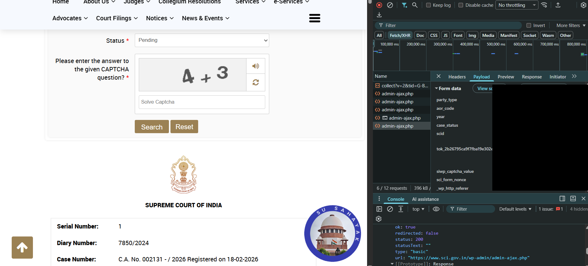
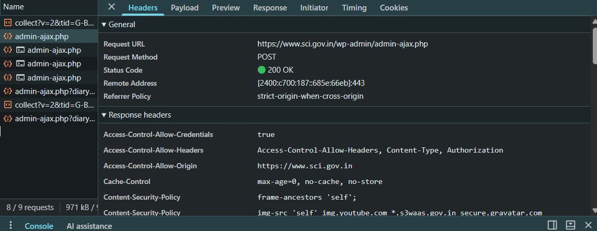
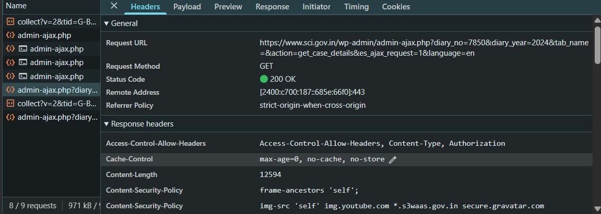
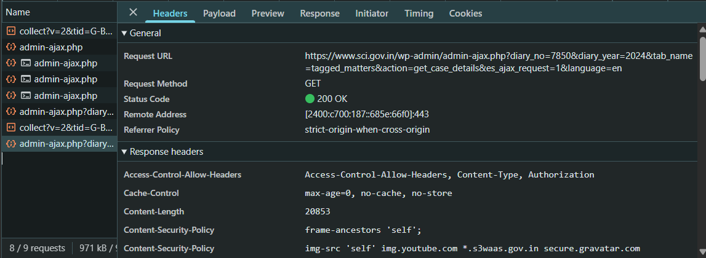

# Supreme Court Case Search and Image Solver Report

**Assessment date:** 25 November 2026. This report summarizes the observed CAPTCHA behavior, three API request/response examples, and the project implementation.

## Part A — CAPTCHA investigation

### What I observed

- The case-status page shows an arithmetic CAPTCHA image before returning case results.
- The CAPTCHA image URL contains an image identifier. The search request also contains a challenge reference, the entered answer, and other form/session values.
- For a particular image URL, the same image appeared in different browser sessions. The image therefore appears to be tied to that URL identifier rather than generated separately for each browser session.
- An incorrect answer appeared to leave the displayed challenge unchanged. After a successful answer, the displayed challenge changed.
- A successful submission consumes or replaces that challenge. A wrong attempt leaves the same challenge visible, so another answer can be entered while the challenge remains valid.
- The observed challenge lifetime is approximately **10 minutes**, unless it is answered correctly sooner. This is an approximate observation.
- A successful search returned JSON with `success: true`; case rows were carried as HTML in `data.resultsHtml`.
- The returned table contains diary number/year values. The preview page uses those values to request case details and optional detail tabs.
- The supplied follow-up request samples do not contain CAPTCHA fields. The project code sends those follow-up requests without CAPTCHA fields as well. This describes the observed samples and local code, not every possible upstream check.

Because the same URL displayed the same challenge across sessions, the image and its answer can be associated with that challenge URL while it is active. A successful submission or the approximate 10-minute expiry changes the challenge, so a stored answer becomes stale after that point. The evidence shows one successful submission consumes the challenge; it does not show that a consumed answer works again.

### Evidence and limits

The supplied DevTools screenshots show the search POST payload and `200 OK` status, the base case-details GET with `200 OK`, and the tab-details GET with `200 OK`. The pasted response samples show one response for each of the three request types below. Manual checks showed the same image for a particular URL across sessions, no image change after an incorrect answer, and a new image after a correct answer or approximately 10-minute expiry.

The screenshots below are the supplied evidence. Cookies, tokens, nonces, challenge IDs, and personal case data should be redacted before sharing the report outside the authorized assessment.

#### Search request payload



#### Search request status



#### Base case-details request status



#### Case-detail tab request status



### Part A conclusion

Based on the observations, plan for one successful CAPTCHA solution for each initial advocate-search request. A successful submission changes the challenge, so one accepted solution does not cover multiple successful searches. An incorrect attempt leaves the image available for another try. The challenge appears to expire after about 10 minutes if it has not already been answered correctly.

The same image URL returns the same challenge across browser sessions. This makes the image URL a stable reference to the active challenge; after success or expiry, the challenge changes and any stored answer for the previous image is no longer current.

After the initial search, the supplied case-detail and tab samples use diary identifiers and do not show CAPTCHA fields. One initial search can reveal multiple case rows, and the later detail/tab requests shown in the samples do not require another CAPTCHA. Each separate initial advocate search requires its own accepted CAPTCHA. The observed minimum is one successful CAPTCHA per initial search, with additional attempts when an answer is incorrect or a challenge expires before acceptance.

### API request and response summary

The supplied request and response samples show three request types. The endpoint is `https://www.sci.gov.in/wp-admin/admin-ajax.php`. Sensitive cookie, token, challenge, and nonce values are intentionally omitted or redacted below.

#### 1. Initial advocate case search

**Request**

```http
POST https://www.sci.gov.in/wp-admin/admin-ajax.php
Content-Type: application/x-www-form-urlencoded; charset=UTF-8
X-Requested-With: XMLHttpRequest
```

```text
party_type=any
aor_code=<advocate code>
year=<year>
case_status=<status>
scid=<redacted challenge identifier>
tok_<dynamic token name>=<redacted>
siwp_captcha_value=<answer entered by user>
sci_form_nonce=<redacted>
_wp_http_referer=/case-status-aor-code/
_form_time=<redacted>
_form_signature=<redacted>
es_ajax_request=1
submit=Search
action=get_case_status_aor_code
language=en
```

**Response shape**

```json
{
  "success": true,
  "data": {
    "pagination": false,
    "resultsHtml": "<div>... [case results HTML omitted] ...</div>"
  }
}
```

The provided sample showed HTTP `200 OK`. The HTML contained a results table, including diary number/year and case summary columns. The full HTML is omitted because it is large and contains case data.

#### 2. Base case details

**Request**

```http
GET https://www.sci.gov.in/wp-admin/admin-ajax.php?diary_no=<diary number>&diary_year=<diary year>&tab_name=&action=get_case_details&es_ajax_request=1&language=en
X-Requested-With: XMLHttpRequest
```

**Response shape**

```json
{
  "success": true,
  "data": "<div>... [case-details HTML omitted] ...</div>"
}
```

The supplied screenshot showed HTTP `200 OK`. The returned `data` value was HTML for the case-details view.

#### 3. Case-detail tab

**Request**

```http
GET https://www.sci.gov.in/wp-admin/admin-ajax.php?diary_no=<diary number>&diary_year=<diary year>&tab_name=tagged_matters&action=get_case_details&es_ajax_request=1&language=en
X-Requested-With: XMLHttpRequest
```

**Response shape**

```json
{
  "success": true,
  "data": "<tr>... [tab table HTML omitted] ...</tr>"
}
```

The supplied sample used `tagged_matters`; other tab names may return different HTML. The request example contains no CAPTCHA fields.

The three supplied examples document one request of each type. They show no CAPTCHA fields on the two follow-up request examples. That is evidence about these examples, not proof that the upstream service never applies other checks. The local preview page calls `POST /solve-captcha` for its search action and `GET /api/case-details` for the case view and its tabs; `src/server.js` proxies those requests to the upstream endpoint above.

**Credential handling:** The pasted request examples included session-cookie and token values. They are not reproduced in this report. Treat them as exposed: invalidate the browser session (for example, sign out or clear the site's cookies) before continuing, and redact cookies, tokens, nonces, and challenge IDs from future samples.

